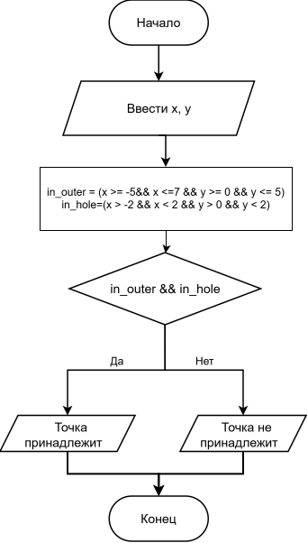

# Домашнее задание к работе 6

## Условие задачи (Вариант 30)

Определить, попадает ли точка с заданными координатами (x, y) в заштрихованную область на плоскости.

По графику (вариант № 30) заштрихованная область представляет собой внешний прямоугольник $-5 \le x \le 7$, $0 \le y \le 5$ с внутренним не заштрихованным вырезом $-2 < x < 2$, $0 < y < 2$.

Пользователь вводит с клавиатуры вещественные координаты точки x и y. Программа выводит псевдографическое изображение области и сообщает, лежит ли точка в заданной области.

---

## 1. Алгоритм и блок-схема

### Алгоритм

1. Настроить русскую локализацию для корректного вывода сообщений.
2. Запросить у пользователя и ввести вещественные координаты точки: `x` и `y`.
3. Вывести псевдографическое изображение заштрихованной области.
4. Проверить попадание точки во внешний прямоугольник: `x >= -5.0f && x <= 7.0f && y >= 0.0f && y <= 5.0f`.
5. Проверить попадание точки во внутренний вырез: `x > -2.0f && x < 2.0f && y > 0.0f && y < 2.0f`.
6. Проверить общее условие принадлежности области: `in_outer && !in_hole`.
7. Если условие истинно, вывести сообщение о том, что точка принадлежит заштрихованной области.
8. Если условие ложно, вывести сообщение о том, что точка не принадлежит заштрихованной области.
9. Завершить работу программы.

### Блок-схема



---

## 2. Реализация программы

Исходный код программы: [6lab.c](6lab/6lab.c)

---

## 3. Результаты работы программы

Пример 1 — точка внутри области (x = 3, y = 2):

```text
Введите координаты x, y:
3
2
              y               
              ^               
  +-----------+-----------+   
  |           |           |   
  |           |           |   
  |     +-----+-----+     |   
  |     |     |     |     |   
--+-----+-----------+-----+->x
 -5    -2     0     2     7   
Точка (3.00, 2.00) ПРИНАДЛЕЖИТ заштрихованной области.
```
Пример 2 — точка вне области (x = 0, y = 1):

```text
Введите координаты x, y:
0
1
              y               
              ^               
  +-----------+-----------+   
  |           |           |   
  |           |           |   
  |     +-----+-----+     |   
  |     |           |     |   
--+-----+-----------+-----+->x
 -5    -2     0     2     7   
Точка (0.00, 1.00) НЕ ПРИНАДЛЕЖИТ заштрихованной области.
```
---

## 4. Информация о разработчике

- **ФИО:** Хлебников Иван Алексеевич
- **Группа:** бОТИ-261
